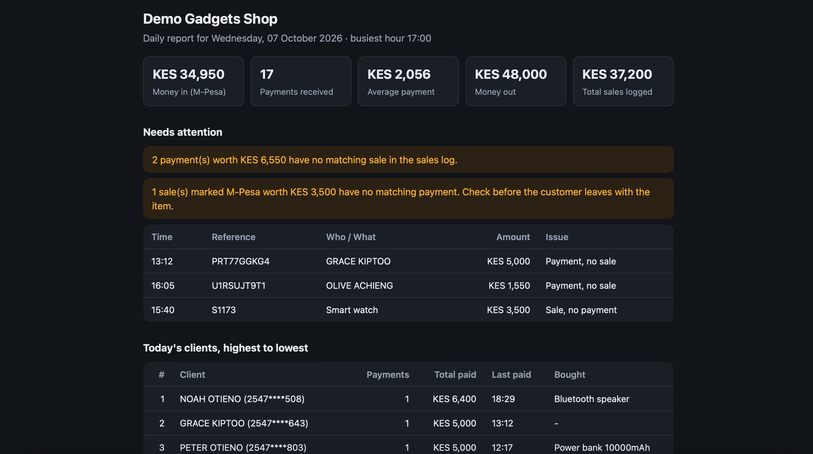

# shop-daily-report

Turn a small shop's **M-Pesa statement**, **sales log** and **stock list** into a one-page daily report, a permanent sales history, and low-stock alerts.

   

Pure Python standard library. No installs needed to run it. Sample report: [`docs/sample_report.html`](docs/sample_report.html).

> **All data in this repo is fake.** Names, phone numbers, receipts and amounts are randomly generated by `generate_sample_data.py`. The statement layout is modelled on typical M-Pesa statement exports; adjust the column names in `shopreport/parsers.py` to match a real export.

## What it answers

1. **How much money came in and went out today?**
2. **Who paid, highest to lowest, and what did they buy?** (ranked client list)
3. **Does every M-Pesa payment match a sale, and every M-Pesa sale a payment?**
4. **What is running low?** and the owner gets a message when it is.
5. **What has the shop sold, ever, and to whom?** (searchable history)

## Features (v0.2)

- **Daily summary:** money in/out, payments, average payment, busiest hour.
- **Ranked clients:** everyone who paid today, highest total first, with the items they bought (from reconciliation).
- **Reconciliation:** pairs each payment with a logged M-Pesa sale of the same amount within a time window (default 30 min) and flags *payment with no sale* and *sale with no payment*.
- **History in SQLite:** every run adds to a local database. Re-importing the same statement never creates duplicates (receipt numbers and sale ids are unique). Query by client, item or date and export to CSV.
- **Smart low-stock alerts:** per-item reorder level, **fires once** when an item drops to or below it (not only when it equals it exactly), escalates when it hits zero, reminds weekly, and resets after restocking. Sends to the console or Telegram.
- **Privacy by default:** full phone numbers are masked (`2547****123`) before storage or display.
- Outputs a self-contained, phone-friendly HTML report (with dark mode) plus CSVs.

## Quick start

```bash
git clone https://github.com/<Nelvin-Mwendwa>/shop-daily-report.git
cd shop-daily-report

python3 generate_sample_data.py        # fake data into sample_data/

python3 -m shopreport report \
  --statement sample_data/mpesa_statement.csv \
  --sales sample_data/sales_log.csv \
  --inventory sample_data/inventory.csv \
  --shop-name "Demo Gadgets Shop" \
  --db shop.db --notify console
```

Open `reports/daily_report_<date>.html` in a browser. On Windows use `python` instead of `python3` and put the command on one line.

### Look through the sales history

```bash
python3 -m shopreport history --db shop.db                         # latest sales
python3 -m shopreport history --db shop.db --client OTIENO         # one client
python3 -m shopreport history --db shop.db --item charger --since 2026-10-05
python3 -m shopreport history --db shop.db --out all_sales.csv     # export everything
```

### Telegram alerts (optional)

1. In Telegram, message **@BotFather**, create a bot, and copy the token.
2. Message your new bot once, then find your chat id (for example via the `getUpdates` method of the Bot API).
3. Run with the variables set:
   ```bash
   export TELEGRAM_BOT_TOKEN="123:abc"
   export TELEGRAM_CHAT_ID="123456789"
   python3 -m shopreport report ... --db shop.db --notify telegram
   ```
If sending fails, the report is still produced and a warning is printed.

## Input formats

| File | Columns |
|---|---|
| `mpesa_statement.csv` | `Receipt No, Completion Time, Details, Transaction Status, Paid In, Withdrawn, Balance` |
| `sales_log.csv` | `sale_id, timestamp, sku, item, qty, amount, payment_method` (`mpesa` or `cash`) |
| `inventory.csv` | `sku, item, price, qty_on_hand, reorder_level` |

## Limits to be aware of

- The client list only covers **M-Pesa payers**. Cash customers aren't identified in a statement.
- Stock numbers are only as accurate as the sales and deliveries someone records. Do regular stock counts.
- Customer names and numbers are personal data. If you use real data, get the owner's clear permission, store only what you need, keep the database out of Git (`*.db` is ignored), and check Kenya's Data Protection Act requirements.
- This is a reporting helper, not accounting or tax software.

## Tests

```bash
python3 -m pip install -r requirements-dev.txt
python3 -m pytest
```

## Project layout

```
shopreport/
  parsers.py    # CSV loading, amount/time parsing, phone masking
  analysis.py   # daily summary, reconciliation, client ranking, low stock
  db.py         # SQLite history (idempotent imports, matches, alert state)
  alerts.py     # alert rules + console/Telegram notifiers
  render.py     # HTML report
  cli.py        # `report` and `history` commands
generate_sample_data.py   # seeded fake data generator
tests/
```

## Roadmap

- Import adapters for common POS/inventory exports (column-mapping config)
- M-Pesa-only mode for shops without a sales record
- SMS / WhatsApp alerts
- Dead-stock report, end-of-day cash tally, profit per item
- Live payment confirmations through the Safaricom Daraja API

## License

MIT
